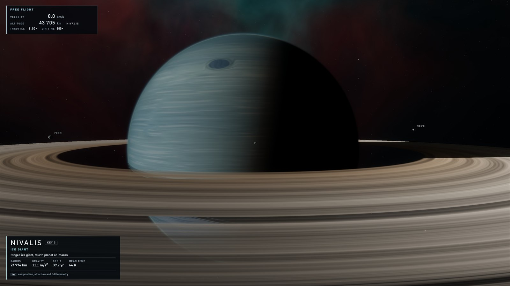
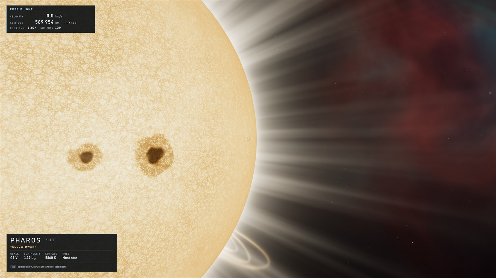
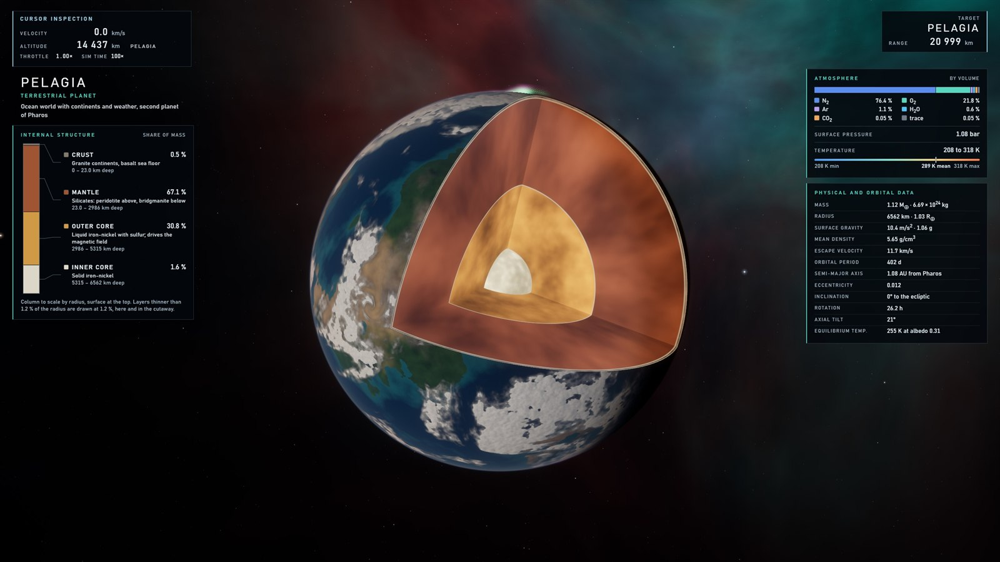

# Pharos

A star system you can fly through, in one HTML file.

**[Open Pharos in your browser](https://divagicha.github.io/pharos/)**



Pharos is a real-time space simulation that runs in the browser on WebGPU.

- **One file.** [`index.html`](index.html) is the whole thing: code, shaders, scientific data and interface. It is 191 KB (64 KB gzipped).
- **No dependencies.** No engine, no libraries, no textures, models or fonts, and no network requests. Every surface, cloud, ring and star is computed on the GPU from formulas.
- **Runs anywhere a page does.** Open it from the link above, or download the file and open it from disk. There is no server, no install and no build step.

## Run it

- **Online:** https://divagicha.github.io/pharos/
- **From disk:** download [`index.html`](index.html) (the "Download raw file" button on its page) and double-click it.

Add `?tour=1` to the address for a 60-second tour of the system, for example https://divagicha.github.io/pharos/?tour=1.

### Requirements

- A recent desktop Chrome or Edge with hardware acceleration on. Pharos needs WebGPU and its `dual-source-blending` feature; if either is missing, the page says so instead of starting.
- A discrete GPU is recommended. On a laptop RTX 3070 Ti a frame takes about 2 ms of GPU time at 2560x1440.

## Controls

| Input | Action |
|---|---|
| `W` `A` `S` `D` | Move |
| Mouse | Look |
| `Q` `E` | Roll |
| `R` `F` | Rise, sink |
| `Shift` | Boost |
| Mouse wheel | Speed |
| `1` to `9` | Warp to a star or planet on autopilot |
| `Space` | Switch between flight and cursor mode |
| Click | Select a body |
| `Tab` | Inspect the selected body: telemetry panels and a cutaway of its interior |
| `Esc` | Close the panels, clear the selection |

In cursor mode, drag the cutaway to turn it and point at a layer to highlight it.

## What is in it



- **A system at true scale:** five stars and a pulsar across five star systems, four planets, seven moons, a comet, an asteroid belt and a ring system. Distances are real, from interstellar space down to a few hundred kilometres above a surface, without jitter.
- **Procedural everything:** boiling star surfaces with sunspots, coronas and loops; a lava world; an ocean world with continents, clouds, city lights and aurora; a banded gas giant with storms; a ringed ice giant; moons; a comet with ion and dust tails; a pulsar with beams; a nebula sky.
- **Light that behaves:** Rayleigh and Mie scattering in atmospheres, scattering in the rings, eclipses, ring shadows on the planet and the planet's shadow on its rings.
- **A science readout:** select any body to see its mass, gravity, orbit, composition and internal structure. Every figure is derived from the body's base parameters in [`src/data/system.json`](src/data/system.json), the same ones that drive its motion.
- **Smooth by construction:** the simulation allocates no memory while it runs, so there are no garbage-collection pauses.



## Status

Pharos is a work in progress. Everything above works, but some things still look rough: the cloud layer seen from afar, the lava world's night side, the pulsar's beams, and the rings seen exactly edge-on. It has been tested on Chrome on Windows 11 with an NVIDIA GPU.

## Build from source

`index.html` is built from `src/`. Building needs Node.js 22 or later; the shader check also needs an installed Chrome.

```sh
npm install
npm run build      # writes dist/index.html, the same file as index.html here
npm test           # unit tests
npm run check      # compiles every shader and render pipeline in Chrome
```

| Path | What it holds |
|---|---|
| `src/js/` | Simulation, renderer, camera and flight, interface, tour |
| `src/*.wgsl` | Shaders |
| `src/data/system.json` | Base parameters of every body |
| `test/` | Unit tests |
| `tools/` | Build script, shader check and other development tools |

## License

[MIT](LICENSE)
